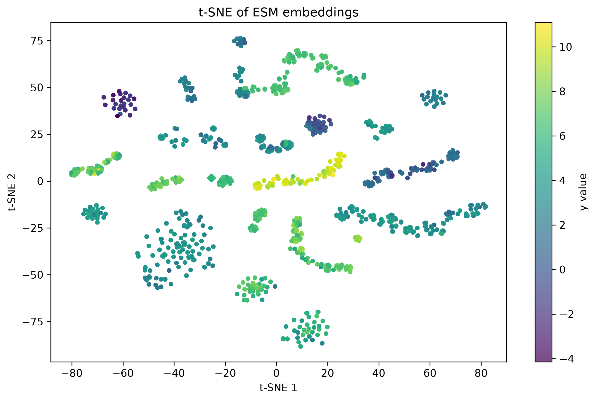
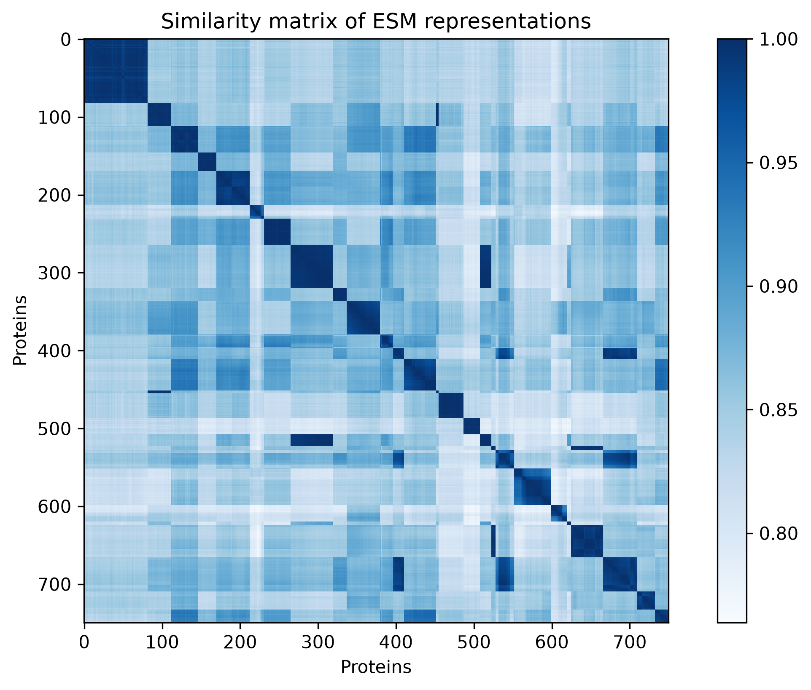
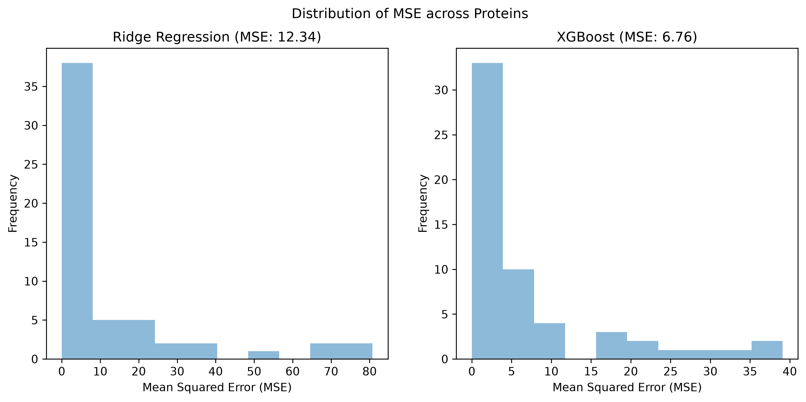
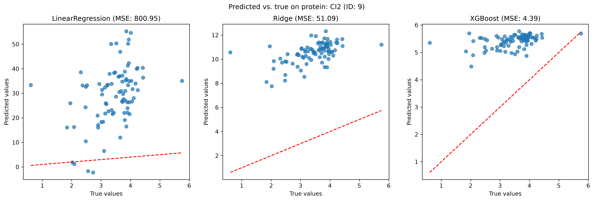

# Protein Sequence-Based Prediction of Folding Kinetics

Machine learning workflow for predicting protein folding kinetics ($\ln(k_f)_{H_2O}$) from amino acid sequences using ESM protein language model embeddings and supervised regression.

## Key Findings
- Evaluated on 57 held-out proteins (leave-one-protein-out CV) **XGBoost on ESM embeddings gave the lowest error** mean per-protein MSE 6.76 (median 2.51) and mean per-protein RMSE 2.11 compared to Ridge and Linear regression.

- Performance varies strongly protein proteins XGBoost MSE < 1 for 13 proteins and > 10 for 10 proteins.

- The model does not capture variation between mutations of an unseen protein. For the 34 proteins where $R^2$ can be computed, XGBoost has a positive $R^2$ for only 5 (median $R^2 = -1.77$), i.e. within a held-out protien it usually predicts worse than the mean of that protein's mean. 

- XGBoost is not uniformly better than regularized linear models in nested CV Ridge regression beat XGBoost in 2 of 5 folds.

## Overview

Protein folding kinetics describe how quickly a protein transitions from an unfolded state to its native, functional structure. Understanding the factors that influence folding rates can provide insight into protein stability, folding mechanisms, and the effects of mutations.

This project explores whether protein sequence information can be used to predict folding kinetics using experimental data from the K-Prot database. The workflow combines SQL-based data management, Python data processing, exploratory data analysis, and machine learning to investigate relationships between protein sequence, mutations, experimental conditions, and folding rates.

## Objectives

- **Data integration:** Retrieve and organize protein folding kinetics data from the K-Prot API into a relational MySQL database.
- **Data quality:** Validate records, handle missing values, standardize experimental metadata, and prepare a consistent modeling dataset.
- **Exploratory data analysis:** Investigate the distributions of folding rates and the influence of experimental conditions, measurement methods, and publications.
- **Sequence-based prediction:** Develop machine-learning models to predict folding kinetics from protein sequence information and mutation contexts.
- **Generalization:** Evaluate model performance on unseen proteins to assess whether the learned relationships extend beyond the training dataset.

## Data Source

The project uses experimental protein folding kinetics data from K-Prot, including protein identifiers, mutations, sequence information, kinetic measurements, and experimental metadata.

**Primary data source:** [K-Prot API](https://folding.biofold.org/k-pro/api)

The dataset includes measurements such as the logarithm of the folding rate extrapolated to water (`ln_kf_h2o`), alongside other kinetic and experimental variables where available.

## Project structure
    .
    ├── 1_Data_acquisition.py              # Retrieve data from the K-Prot API -> data/raw/*.json
    ├── 2_ETL_and_data_validation.py       # Clean, validate and load into MySQL
    ├── 3_Exploratory_data_analysis.ipynb  # EDA on the SQL modelling dataset
    ├── 4_Feature_engineering.py           # Generate and cache ESM embeddings
    ├── 5_Modelling_and_evaluation.py      # Tuning, leave-one-protein-out CV, plots
    ├── sql/                               # Database scripts (e.g. sort_data.sql, model_dataset.sql)
    ├── src/Protein_Sequence_Based_Prediction_of_Folding_Kinetics/
    │                                      # Installable package used by the scripts
    ├── data/
    │   ├── raw/                           # Saved API responses (JSON)
    │   └── processed/                     # Cached ESM embeddings
    ├── reports/
    │   ├── figures/                       # Plots shown below
    │   └── results/                       # Cross-validation result tables (CSV)
    └── pyproject.toml                     # Package definition

## Database Schema
The MySQL database (default name `kpro`) separates protein-level information from experimental observations:

| Entity | Contents |
| --- | ---|
| Proteins | One row per protein: identifiers (including UniProt ID), name, length, classification and the reference sequence |
|Mutations |	Mutation annotations in PDB and UniProt numbering (wild-type entries are marked WT), with the sequence context used for embeddings |
| Structures | PDB structure information linked to proteins |
| Publications | Source of each measurement: authors, reference, year, PMID |
| Experiments | Experimental conditions: temperature, pH, buffer, ions, additives, measurement method |
| Kinetic measurements | The measured values, such as $\ln(k_f)_{H_2O}$, $\ln(k_u)_{H_2O}$ and denaturant-dependent terms, each with a measurement_id |

Design notes:

- Each measurement is linked to a mutation (or the wild type) and its protein, so related observations can be grouped by protein_id when splitting data for evaluation.

- Uniqueness constraints prevent duplicate rows when the ETL pipeline is rerun. Because many records lack some measurements, the constraints use non-null identifiers.

- sql/sort_data.sql is applied after loading, and sql/model_dataset.sql produces the modelling dataset (measurement_id, protein_id, mutation_id, mutation annotations, reference and mutation sequence contexts, and ln_kf_h2o) that is joined with the embeddings.

## Methodology

### 1. Data acquisition and ETL

Data are retrieved from the K-Prot API and processed using a Python-based extract, transform, load (ETL) workflow.

The pipeline is designed to:
- Retrieve experimental records and relevant protein sequence information.
- Validate identifiers, mutations, and sequence references.
- Extract protein sequence and apply mutations based on UniProt IDs.
- Standardize data types and experimental metadata.
- Store structured records in a relational MySQL database.

Findings and adjustments
- **Duplicate API records:** Queries using UniProt IDs as endpoints returned duplicate records. Exact duplicate rows are removed during data transformation to avoid redundant entries.

- **Missing experimental measurements:** Many records lack one or more experimental measurements. These records are retained when sufficient information is available to identify the protein. Database uniqueness constraints are designed to accommodate missing measurement using non-null unique identifiers.

- **Validation outcomes:** Validation failures are recorded in the pipeline logs. Processing continues when an error is non-fatal, while insufficient data or identification information causes the pipeline to exit when further processing is not possible.

- **Mutation–reference mismatches:** Approximately 5% of records fail mutation validation because the wildtype amino acid specified in the mutation annotation does not match the corresponding residue in the UniProt reference sequence. These records are flagged during validation but are not investigated further in the current analysis.

### 2. Data quality and exploratory analysis

The analysis workflow retrieves a modeling dataset from SQL and assesses its completeness, consistency, and suitability for prediction.

Exploratory analysis focuses on:
- Folding-rate distributions and potential outliers.
- Missing data and coverage across proteins and mutations.
- Relationships between folding kinetics and experimental conditions, including temperature, pH, and measurement method.
- Differences between publications and potential confounding factors.
- The representation of wild-type and mutant sequences.

Findings:
- **Folding-rate distribution:** The target variable, $(\ln(k_f)_{H_2O})$, spans ~ −3.5 to 12.5 showing good coverage of most the common range for proteins. The distribution appears approximately normal, with most observations spread across the central range and a small number of outliers at the lower end. These extreme observations are retained, as the still fall within a physically reasonable range.

- **Sequence coverage:** ~ 5% of protein entries lack a sequence value because the wild-type residue specified in the mutation annotation does not match the corresponding residue in the UniProt reference sequence. These cases are flagged during validation. Given the remaining sequence coverage, the discrepancy is not investigated further in the current analysis.

- **Missing experimental data:** Experimental records have varying levels of completeness, with some measurements or metadata unavailable. This limits the number of observations that can be used for analyses involving specific experimental variables and may result in different sample sizes across comparisons.

- **Experimental heterogeneity:** Folding-rate measurements are compiled from multiple publications and experimental conditions. Differences in temperature, pH, measurement method, and other conditions may contribute to variation in folding rates independently of sequence differences. In addition, most measurement methods cover only a subset of the observed $\ln(k_f)_{H_2O}$ range, resulting in uneven target-value coverage across methods. These factors may introduce systematic biases and should be considered when interpreting model performance and the apparent effects of protein mutations.

- **Wild-type and mutant representation:** The dataset includes wild-type and mutated protein sequences, with some proteins represented by multiple mutations or experimental observations. This creates a risk of related observations appearing in both training and test sets. Evaluation should therefore account for shared protein identities and repeated measurements when assessing generalization to unseen proteins.

### 3. Feature engineering

Protein sequences are transformed into ESM embeddings to generate numerical representations that capture sequence patterns and potentially encode structural and evolutionary information.

Findings

- **t-SNE visualisation:** The t-SNE projection shows some clustering of proteins with similar $\ln(k_f)_{H_2O}$ values, suggesting that the embeddings may capture sequence information relevant to folding kinetics. However, the relationship is not consistent across all observations. Interpretation should also be cautious, as t-SNE is a nonlinear dimensionality reduction technique that prioritises local neighbourhood preservation. The global structure of the 2D projection may not reflect relationships in the original 2,560-dimensional embedding space. The visualisation alone therefore does not establish predictive performance.

- **Sequence similarity:** The similarity matrix reveals substantial variation in sequence similarity across the dataset, with some proteins showing relatively low similarity to the other proteins. These proteins may be more challenging to predict for if the training data contain few similar examples. This highlights the importance of evaluating model generalisation to unseen proteins rather than relying solely on random train-test splits.

<p align="center">   </p>

*Left: t-SNE of the ESM embeddings coloured by folding rate. Right: similarity between proteins in embedding space.*

**Future directions:** Alternative sequence representations could be compared to investigate their influence on predictive performance. Another direction would be to predict the change in folding kinetics associated with a mutation relative to the wild-type protein, rather than predicting absolute folding rates. This would require matched wild-type and mutant measurements and could provide a more direct assessment of mutation-associated changes in folding kinetics.

### 4. Model development and evaluation

Three regression models are compared on the ESM embeddings: linear regression, Ridge regression (fixed alpha = 10 in the leave-one-protein-out comparison), and XGBoost (n_estimators = 250, max_depth = 4, learning_rate = 0.05).

- **Leave-one-protein-out CV (LOPO):** each of the 57 proteins is held out in turn and the models are trained on the other 56. This is the primary measure of generalization to unseen proteins.

- **Nested CV:** protein-grouped, 5 outer folds, with inner CV used to tune alpha (Ridge) and n_estimators (XGBoost).

- Different grouping approaches are used in the train/test splits so that related mutations, repeated measurements and shared publications do not leak between training and test sets.

## Results

### Leave-one-protein-out-cross-validation

Values are computed per held-out protein and then summarized over the 57 proteins. Mean RMSE is the average of per-protein RMSEs. The square root of the mean MSE is 2.60 for XGBoost.

Means are dominated by a few badly predicted proteins, so the medians give a more typical picture. XGBoost has lower MSE than Ridge for 33 of 57 proteins and lower than linear regression for 50 of 57.

The very large error of plain linear regression is probably due to overfitting: the embedding has far more dimensions than there are training observations, and the model is unregularized.

| Model | Mean MSE | Median MSE | Mean RMSE | Median  $R^2$ | Proteins with $R^2 > 0$ |
| --- | --- | --- | --- | --- | --- |
| XGBoost | 6.76 | 2.51 | 2.11 | −1.77 | 5 / 34 |
 |Ridge (alpha = 10) | 37.90 | 5.41 | 4.06 | −7.37 | 3 / 34 |
| Linear regression | 2050.03 | 86.39 | 25.01 | −455.62 | 0 / 34 |

<p align="center">  </p>

*Distribution of per-protein performance for each model.*

Full per-protein results are in `reports/results/leave_one_protein_out_results.csv` and `reports/results/model_performance_summary.csv`.

### Nested cross-validation

- XGBoost has the lower mean MSE (9.37 vs 20.03) and wins 3 of 5 folds, but tuned Ridge is better in folds 1 and 3. Error varies a lot between folds (XGBoost 3.4 to 20.1), so results are sensitive to which proteins are in the test set.

- XGBoost achieved a lower MAE than Ridge Regression across all five outer folds, indicating smaller average absolute prediction errors. However, XGBoost achieved a lower RMSE in only three folds, suggesting that its performance relative to Ridge was less consistent when larger prediction errors were given greater weight. 

- **Ridge:** alpha = 100, the largest value in the grid, was selected in every fold, and the inner-CV MSE falls steadily as alpha increases (mean 221 at 0.01 down to 10.9 at 100). The best value is therefore probably above the tested range, and the grid should be extended.

- **XGBoost:** inner-CV error is almost flat across n_estimators (mean MSE 9.23 at 100 and about 9.05 from 500 to 1000), and different values are selected in different folds. The number of trees has little effect here, so the differences between selected values should not be over-interpreted.

| Outer fold | Test proteins | Ridge MSE (alpha) | XGBoost MSE (n_estimators) |
| --- | --- | --- | --- |
| 1 | 12 | 12.96 (100) | 14.27 (250) |
| 2 | 12 | 34.05 (100) | 20.10 (1000) |
| 3 | 11 | 2.80 (100) | 3.38 (750) |
| 4 | 11 | 18.85 (100) | 4.69 (250) |
| 5 | 11 | 31.50 (100) | 4.39 (500) |
| Mean ± SD	| | 20.03 ± 13.01 |	9.37 ± 7.45 |

Per-fold and inner-CV tables are in `reports/results/` (`ridge_nested_cv.csv`, `xgboost_nested_cv.csv`, `ridge_inner_cv.csv`, `xgboost_inner_cv.csv`).

### Variation between proteins

Prediction error differs strongly between held-out proteins. The XGBoost MSE ranges from almost zero to 39.1; it is below 1 for 13 proteins and above 10 for 10 proteins. Because $R^2$ is negative for most proteins, the model mostly does not track variation between different mutants of the same protein. Poorly predicted proteins tend to be those with low similarity to the rest of the dataset in the similarity matrix.

<p align="center">  </p>

*True versus predicted $\ln(k_f)_{H_2O}$ for the most frequently measured protein when held out.*

### Interpretation

XGBoost gives the lowest average error, which suggests that a nonlinear model can extract patterns from the ESM embeddings that an untuned linear model cannot. The advantage is not uniform, since Ridge wins in some nested-CV folds. The current results also do not show how much of the predictive information comes specifically from the sequence embeddings.

## Conclusion

ESM embeddings combined with XGBoost can predict folding rates for proteins that have some similarity to proteins in the training data, with a typical per-protein RMSE of about 2 ln units. The model is unable to capture variation between mutations of unseen proteins, and accuracy drops for proteins dissimilar to the rest of the dataset.

## Limitations

- Few distinct proteins (57) relative to the dimensionality of the embeddings, and strong variation in performance between proteins.

- Heterogeneous experimental conditions (temperature, pH, method, publication) are not included as model inputs, so some variation may reflect experimental differences rather than sequence.

- About 5% of records are excluded from sequence-based modelling because of wild-type mismatches with the UniProt reference.

- No non-embedding baseline has been evaluated, and the Ridge hyperparameter grid does not contain the optimum.

## Technology Stack

- **Programming:** Python
- **Data processing:** pandas, NumPy
- **Database:** MySQL, SQL
- **Data acquisition:** REST API, JSON
- **Visualization:** Matplotlib, Seaborn
- **Machine learning:** scikit-learn, XGBoost
- **Protein representations:** ESM protein language models
- **Development:** Git, Jupyter Notebook

## Getting Started

### Requirements

- Python 3.10
- MySQL
- Access to the K-Prot dataset or a prepared local dataset

### Installation

The scripts import the project's own package (`Protein_Sequence_Based_Prediction_of_Folding_Kinetics, in src/`), so install it into your environment first:

```bash
git clone https://github.com/isasunde/Protein-Sequence-Based-Prediction-of-Folding-Kinetics.git
cd Protein-Sequence-Based-Prediction-of-Folding-Kinetics

python -m venv .venv
source .venv/bin/activate        # Windows: .venv\Scripts\activate

pip install -e .                 # installs the package and the dependencies declared in pyproject.toml
```

Create the database, then create a .env file in the project root with your connection details:
```sql
CREATE DATABASE kpro
```

```text
MYSQL_HOST=localhost
MYSQL_PORT=3306
MYSQL_USER=your_username
MYSQL_PASSWORD=your_password
MYSQL_DATABASE=kpro
```

### Running the pipeline

Run the steps in numerical order from the project root:
| Step | Command | What it does | Output |
| 1 | `python 1_Data_acquisition.py`| Downloads records from the K-Prot API | `data/raw/*.json` |
| 2 | `python 2_ETL_and_data_validation.py` | Cleans, adds sequences, validates and loads into MySQL, then applies `sql/sort_data.sql` | MySQL tables |
| 3 | `jupyter notebook 3_Exploratory_data_analysis.ipynb` | Exploratory analysis of the modelling dataset | Figures in the notebook |
| 4 | `python 4_Feature_engineering.py` | Computes ESM embeddings for the sequence contexts | `data/processed/esm_embeddings.csv`| 
| 5 | `python 5_Modelling_and_evaluation.py`| Nested CV, leave-one-protein-out CV and plots | `reports/results/*.csv, reports/figures/*.png` |

## Future Work

- Add baselines that do not use embeddings (training mean, sequence length, amino acid composition) to quantify what the embeddings contribute.

- Extend the Ridge alpha grid beyond 100 and rerun the LOPO comparison with the tuned value.

- Compare alternative sequence representations, including wild-type-to-mutant embedding differences.

- Predict mutation-induced changes in folding kinetics from matched wild-type and mutant measurements.

- Evaluate generalization across publications as well as proteins.

- Quantify model uncertainty and identify limitations arising from heterogeneous experimental data.

- Improve reproducibility through automated data validation, testing, and documented analysis workflows.